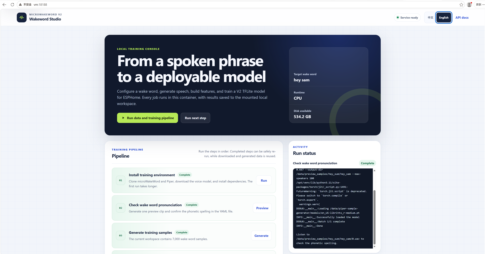

# microWakeWord V2 Trainer

[简体中文](README.md) | [English](README.en.md)

<p align="center">
  
</p>

在本地训练 [microWakeWord](https://github.com/kahrendt/microWakeWord) V2 唤醒词模型。项目沿用原 Colab Notebook 的核心训练流程，并增加了适合本地长期使用的 HTML 控制台、CPU 容器化部署、任务日志和持久化工作区。

本仓库是在原项目基础上的增强版，主要优化包括：

| 优化 | 说明 |
| --- | --- |
| **Web HTML 控制台** | 无需打开 Jupyter Notebook。通过浏览器完成配置、发音预览、样本生成、数据下载、特征构建、训练、模型导出和日志查看。 |
| **中英文界面** | 控制台顶部可随时切换中文和英文，默认中文，并记住当前浏览器的语言选择。 |
| **CPU 容器化部署** | 提供独立的 `Dockerfile.cpu` 和 `docker compose` 配置。镜像使用 PyTorch CPU wheel，不包含不可用的 CUDA 运行时。 |
| **远程访问** | 默认将 `8188` 映射到宿主机所有网卡，可从局域网或 VPN 远程访问；也可通过环境变量限制为仅本机访问。 |
| **持久化数据** | 样本、数据集、模型、日志和配置保存在宿主机 `workspace/`，重建容器不会删除训练结果。 |
| **国内网络优化** | 支持 Hugging Face 镜像、HTTP/HTTPS/SOCKS 代理、PyPI 镜像，并针对 HTTP 代理关闭不兼容的 Hugging Face Xet 传输。 |
| **多语言文档** | 默认提供中文 README，并保留完整英文文档。 |

## 快速开始：Docker CPU 版

需要 Docker 和 Docker Compose。推荐准备约 30–40 GB 可用磁盘空间，用于背景音频、特征和训练结果。

```bash
cd ~/github/dfxiang/MicroWakeWordV2Trainer
cp .env.example .env
docker compose up --build -d
```

在宿主机打开 <http://127.0.0.1:8188>，或从其他设备访问：

```text
http://<宿主机IP>:8188
```

停止服务但不删除数据：

```bash
docker compose down
```

查看容器日志：

```bash
docker compose logs -f trainer
```

> **安全提示：** 控制面板目前没有登录认证。暴露到局域网或公网时，只应开放给可信网络，或将其放到带认证的反向代理、VPN 后面。

## HTML 控制台功能

打开 Web 页面后可以：

1. 编辑并校验 `workspace/wakeword_config.yaml`。
2. 运行运行环境 Setup。
3. 输入唤醒词音标，生成并试听发音预览。
4. 批量生成 Piper 合成样本。
5. 下载 RIR、Audioset、FMA 和负样本数据。
6. 预览增强后的音频，构建频谱特征。
7. 启动训练，实时查看日志并取消正在运行的任务。
8. 下载导出的 `.tflite` 模型和 ESPHome V2 `.json` 清单。

所有任务通过单一进程管理，避免同时启动多个训练任务。任务输出写入 `workspace/logs/`。

## Docker 配置

配置文件：[compose.yaml](compose.yaml)

镜像定义：[Dockerfile.cpu](Dockerfile.cpu)

环境变量示例：[.env.example](.env.example)

Docker Compose 会将 `/opt/venv` 保存到 `trainer-venv` 命名卷，避免容器重建后
Setup 安装的 Python 依赖丢失。`docker compose down` 会保留该卷；
`docker compose down -v` 会删除它，需要重新运行 Setup。

常用环境变量：

| 变量 | 默认值 | 说明 |
| --- | --- | --- |
| `TRAINER_BIND_HOST` | `0.0.0.0` | Web 服务绑定地址。仅本机访问时设为 `127.0.0.1`。 |
| `TRAINER_PORT` | `8188` | 宿主机端口。 |
| `HF_TOKEN` | 空 | 可选 Hugging Face Token，可降低匿名下载限流。 |
| `HF_ENDPOINT` | 示例中为 `https://hf-mirror.com` | Hugging Face 及其数据集下载地址。 |
| `HF_HUB_DISABLE_XET` | `1` | 关闭部分 HTTP 代理下会断开的 Xet 加速。 |
| `HTTP_PROXY` | 空 | HTTP 代理，例如 `http://host.docker.internal:1080`。 |
| `HTTPS_PROXY` | 空 | HTTPS 代理。 |
| `ALL_PROXY` | 空 | 其他协议的代理回退。 |
| `TRAINER_NO_PROXY` | 本机与国内镜像 | 不需要经过代理的地址。Compose 会将其映射为容器内的 `NO_PROXY`。 |
| `PIP_INDEX_URL` | 华为云 PyPI 镜像 | 容器运行期间安装 Python 依赖使用。 |
| `BUILD_PIP_INDEX_URL` | 阿里云 PyPI 镜像 | 构建镜像时安装依赖使用。 |

若宿主机代理监听 `1080` 端口，可使用：

```dotenv
HTTP_PROXY=http://host.docker.internal:1080
HTTPS_PROXY=http://host.docker.internal:1080
ALL_PROXY=http://host.docker.internal:1080
HF_ENDPOINT=https://hf-mirror.com
HF_HUB_DISABLE_XET=1
TRAINER_NO_PROXY=localhost,127.0.0.1,::1,host.docker.internal
```

修改 `.env` 后重新创建容器：

```bash
docker compose up -d --force-recreate
```

## 训练流程

```text
setup
  → 克隆并安装 microWakeWord 和 piper-sample-generator，下载 Piper 声音模型

preview-word
  → 生成 1 条发音样本并试听，调整唤醒词音标

generate-samples
  → 批量生成 Piper 合成样本

download-data
  → 下载 RIR、Audioset、FMA 背景音频和负样本特征

preview-augment
  → 可选：生成 1 条增强音频，检查增强参数

build-features
  → 生成训练、验证、测试频谱特征

train
  → 训练、量化并转换为流式 .tflite

export
  → 导出 .tflite 和 ESPHome V2 模型清单
```

运行产生的克隆仓库、训练数据、样本、特征、检查点和导出模型都保存在 `workspace/` 中。不同配置文件可以使用不同工作区，从而并行管理多个唤醒词。

## 依赖与运行时间

- Python 3.11 或 Python 3.10；推荐 Python 3.11。
- `git`。
- 每个工作区建议准备 30–40 GB 可用磁盘空间。
- NVIDIA GPU 可选。CPU 也能完成训练，但 10,000 步在一个 CPU 主机上可能超过一小时。
- Windows 原生环境只能使用 CPU；WSL2 和原生 Linux 可以使用 NVIDIA GPU。

参考运行时间：

| 环境 | 完整训练时间 |
| --- | --- |
| Surface Laptop Studio 2，CPU | 约 70–80 分钟；音频下载通常只发生一次，后续模型约 40 分钟。 |
| 同一设备，WSL2 + NVIDIA 4050 | GPU 在 WSL 中的配置仍待验证，预计显著快于 CPU。 |
| AMD 9950X + NVIDIA 2080 Ti，原生 Ubuntu | 包含下载约 30–40 分钟；数据下载完成后每个模型约 5 分钟。 |

## 相比原始 Notebook 的改进

- **补齐训练步骤。** 原始 Notebook 引用了未定义的 `generated_features_output_dir`，且缺少将增强音频转换成频谱特征的步骤。本项目通过 `build_features.py` 和 `build-features` 命令补齐这一步。
- **支持同一唤醒词的多个音标。** 在 `wake_word.additional_phonetics` 中配置不同发音，每个音标都会生成完整样本批次，通常能增强对不同口音的鲁棒性。
- **步骤可重复执行。** 各步骤会检查已有结果并跳过已完成工作，因此中断后可以重新执行。
- **Web 化操作。** 配置、执行、日志、取消任务、音频预览和模型下载都可以在浏览器完成。
- **本地容器部署。** CPU 依赖、系统工具、用户权限和持久化目录都封装在镜像与 Compose 配置中。
- **适应受限网络。** 支持 PyPI 镜像、Hugging Face 镜像和宿主机代理。

## GPU 说明

TensorFlow 2.10 之后不再提供 Windows 原生 GPU 支持，而 microWakeWord 要求 `tensorflow>=2.18`：

- **Windows 原生环境：** 即使有 NVIDIA GPU，训练仍使用 CPU。
- **WSL2：** 可以按标准 WSL2 CUDA 方式将 Windows 的 NVIDIA 驱动透传给 TensorFlow。
- **原生 Linux：** 建议先安装 NVIDIA 驱动和 CUDA 工具包，再安装 CUDA 版 TensorFlow。

CPU Docker 镜像有意不启用 GPU 透传。需要 GPU 训练时，应使用原生 Linux/WSL 环境，或另外维护 GPU 版镜像。

## Windows 原生 CPU 设置

1. 安装 [Python 3.11](https://www.python.org/downloads/) 和 [Git](https://git-scm.com/download/win)。
2. 在项目根目录打开 PowerShell：

   ```powershell
   python -m venv .venv
   .venv\Scripts\Activate.ps1
   pip install -r trainer\requirements.txt
   ```

3. 创建配置：

   ```powershell
   Copy-Item trainer\wakeword_config.example.yaml trainer\wakeword_config.yaml
   ```

4. 至少修改 `wake_word.phonetic` 和 `wake_word.friendly_name`，然后启动交互菜单：

   ```powershell
   python -m trainer.local.cli
   ```

## WSL2 与原生 Linux 设置

1. 安装 Ubuntu。Windows 可执行：

   ```powershell
   wsl --install -d Ubuntu
   ```

2. 安装适用的 NVIDIA 驱动。

   WSL2 只安装 Windows 端驱动，不要在 WSL 内再安装 NVIDIA Linux 驱动。原生 Ubuntu 可按系统提示使用 `ubuntu-drivers`：

   ```bash
   sudo apt-get install ubuntu-drivers-common
   ubuntu-drivers devices
   sudo ubuntu-drivers install
   sudo reboot
   ```

   如需自行安装 CUDA 工具包：

   ```bash
   sudo apt install nvidia-cuda-toolkit -y
   nvidia-smi
   ```

3. 安装 Python 3.11、虚拟环境和构建工具。新版 Ubuntu 可使用 Deadsnakes PPA 或 pyenv 安装 Python 3.11。

4. 安装 Python 依赖：

   ```bash
   git clone https://github.com/dfxiang/MicroWakeWordV2Trainer.git
   cd MicroWakeWordV2Trainer
   python3 -m venv .venv
   source .venv/bin/activate
   pip install -r trainer/requirements.txt
   ```

5. 创建配置：

   ```bash
   cp trainer/wakeword_config.example.yaml trainer/wakeword_config.yaml
   ```

6. 执行 Setup，再安装 CUDA 版 TensorFlow：

   ```bash
   python3 -m trainer.local.cli setup
   pip install "tensorflow[and-cuda]"
   ```

7. 验证 CPU 和可选 GPU：

   ```bash
   python3 -c "import tensorflow as tf; print(tf.reduce_sum(tf.random.normal([1000, 1000])))"
   python3 -c "import tensorflow as tf; print(tf.config.list_physical_devices('GPU'))"
   ```

8. 启动交互菜单：

   ```bash
   python3 -m trainer.local.cli
   ```

如果显存较小并出现 OOM，请降低配置中的 `training.batch_size`（默认值为 128）。

## 命令行运行

不带参数启动交互菜单：

```bash
python3 -m trainer.local.cli
```

也可以单独执行某一步：

```bash
python3 -m trainer.local.cli preview-word
python3 -m trainer.local.cli generate-samples
python3 -m trainer.local.cli download-data
python3 -m trainer.local.cli preview-augment
python3 -m trainer.local.cli build-features
python3 -m trainer.local.cli train
python3 -m trainer.local.cli export --probability-cutoff 0.9
```

使用其他配置文件：

```bash
python3 -m trainer.local.cli --config path/to/wakeword_config.yaml train
```

Setup、样本和配置都完成后，可以连续执行数据下载、特征构建和训练：

```bash
python3 -m trainer.local.cli all
```

如果模型已收敛但训练被中断，可以跳过重新训练，直接转换已有最佳检查点：

```bash
python3 -m trainer.local.cli train --no-train
```

## 多个音标

```yaml
wake_word:
  phonetic: "hey wabi"
  friendly_name: "hey_wabi"
  additional_phonetics:
    - "hey wahbee"
    - "hey wah-bee"
```

每个音标都会生成一个完整的 `piper.max_samples` 样本批次。更多音标可以改善发音覆盖，但也会增加分类难度，应在训练后查看 `tflite_streaming_roc.txt` 再决定是否保留。

## 选择概率阈值

训练完成后，ROC 文件位于：

```text
workspace/trained_models/<name>/tflite_stream_state_internal_quant/tflite_streaming_roc.txt
```

其中：

- `frr`：误拒率，真实唤醒词被漏掉的概率。
- `faph`：环境音和负样本上的估计每小时误唤醒次数。

对于语音助手，通常优先选择 `faph=0.000` 条件下最低的阈值。误唤醒过多时提高阈值；真实唤醒不灵敏时降低阈值。

## 常见问题

- **`No module named 'torchcodec'`**
  新版 `datasets` 解码音频时需要 `torchcodec`。项目固定使用 `datasets<4.0`，且数据下载逻辑不依赖 `datasets`。若错误再次出现，重新安装 `pip install "datasets<4.0"`。

- **`No module named 'piper_train'`**
  PyPI 的 piper-sample-generator 包不包含 `piper_train`。项目会克隆完整源码，并设置 `PYTHONPATH`。

- **`audiomentations` 缺少 `AddColorNoise`**
  项目会在 Setup 中覆盖原始旧版本约束，安装 `audiomentations>=0.35`。

- **`No module named 'pkg_resources'`**
  使用 `setuptools<81`，兼容仍依赖该模块的 `webrtcvad`。

- **`TBNotInstalledError`**
  项目会在 Setup 中安装 `tensorboard`。

- **Hugging Face 下载出现 `Network is unreachable`**
  检查 `.env` 中的 `HF_ENDPOINT` 和代理设置，将宿主机代理写为 `http://host.docker.internal:<端口>`。

- **代理下载发生 `SSL: UNEXPECTED_EOF_WHILE_READING`**
  保持 `HF_HUB_DISABLE_XET=1`，关闭与代理不兼容的 Xet 加速。

- **`build-features` 的分组为空**
  删除对应空目录后重新运行：

  ```text
  workspace/generated_augmented_features/<name>/<split>/
  ```

## 许可证和数据许可

项目代码遵循仓库中的 [LICENSE](LICENSE)。RIR、Audioset、FMA 等训练数据具有不同许可证和使用限制。使用这些数据训练的模型默认只应按个人用途处理，除非你逐一确认各数据源允许商业使用。
